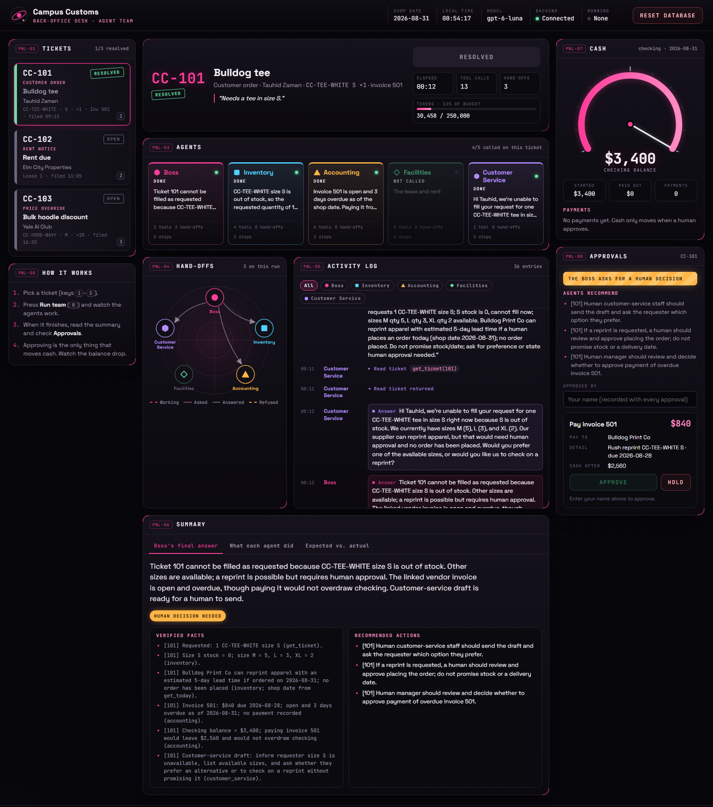

# Campus Customs Desk: design notes

*How the dashboard looks, and why.*

## The idea

Watching an AI team work a ticket is a lot like watching a control room. Several specialists act at once, they hand work to one another, one lead makes the final call, and nothing that costs money happens until a human approves it. So the desk **borrows the look of an aerospace control room** but keeps the **words plain**. Agents are called by their real names (Boss, Inventory, Accounting, Facilities, Customer Service), and every label says what it does.

From the control-room look we kept:
- a near-black deck with bright status lights;
- a radar-style map of hand-offs;
- a gauge for cash;
- rubber-stamp ticket statuses;
- a deliberate two-step approval.

We dropped the jargon (callsigns, "flights", "fuel") after trying it. It looked fun, but people had to translate it in their heads.

*A real gpt-6-luna run on ticket 101. The Boss called Inventory and Accounting together, then Customer Service; Facilities was not called. The approval for invoice 501 is waiting on the right.*

## Layout: three columns, read left to right

| Left: **what's waiting** | Center: **what's happening** | Right: **what it costs** |
|---|---|---|
| Tickets (the 3 open tickets) | Ticket header, **Run team** button, timer and token meter | Cash gauge (checking balance) |
| How it works (4 steps) | Agents (one card per agent) | Payments list |
| | Hand-offs map + Activity log | Approvals |
| | Summary | |

The eye moves the way the work moves. You pick a ticket on the left, watch the agents work in the middle, and make the money decision on the right, next to the gauge it will move. The left and right columns stay pinned while the middle scrolls, so cash and the pending decision are always in view.

On a laptop the right column moves under the others. On a phone everything stacks into one column with a 16px gutter and no sideways scrolling.

## Tickets: a card with a status stamp

Each ticket is a card styled like an air-traffic "flight strip": the ticket number in large type (`CC-101`), the type, subject, requester, and the linked SKU, lease or invoice. A colored edge and a stamp show the status:

| Stamp | Means | Look |
|---|---|---|
| `OPEN` | Not run yet | Grey |
| `RUNNING` | The agent team is working on it | Pink, blinking, glowing edge |
| `RESOLVED` | The run finished, so the ticket is resolved | Green stamp, tilted a few degrees like a rubber stamp |
| `FAILED` | The run stopped with an error | Red |

Resolved tickets get a green stamp and edge, and their subject dims so open work stands out. The panel header keeps count (`1/3 resolved`).

## Agents: same name, color and shape everywhere

Each agent has a **color** *and* a **shape**, so they stay easy to tell apart for color-blind users and in screenshots:

| Agent | Color | Shape | What it does |
|---|---|---|---|
| **Boss** | Pink | ● circle | Routes the work and makes the final call |
| **Inventory** | Cyan | ■ square | Shelf stock, sizes and suppliers |
| **Accounting** | Amber | ▲ triangle | Prices, invoices and cash |
| **Facilities** | Green | ◆ diamond | The lease and rent |
| **Customer Service** | Violet | ⬢ hexagon | Drafts replies; the only voice to customers |

The same name, color and shape follow each agent everywhere: its card, its spot on the hand-offs map, its lines in the activity log, its report in the summary, and its filter button.

### How you see the agents work during a run

- **Agent cards** show a status light (*Idle*, *Working*, *Done*, *Error*, or *Not called*) and a live line of what the agent is doing. The line changes style with the action:
  - *speaking:* italic quote;
  - *using a tool:* monospace in the agent's color, e.g. `Shelf scan · check_inventory(CC-TEE-WHITE · S)`;
  - *finished:* its one-line answer.

  An agent that isn't needed dims to *Not called*. For example, Facilities sits out ticket 101, which is what we expected.
- **Hand-offs** is a small radar-style map with the five agents in a pentagon and the Boss at the top. Every hand-off draws an arrow:

  | Arrow | Means |
  |---|---|
  | Dotted | Asked |
  | Pink, flowing dashes | Working |
  | Thin grey | Answered |
  | Amber dashes | Refused (it would have looped back) |

  A sweep line turns only while a run is going. When the Boss asks two agents at once, two arrows light up at the same moment, which is the clearest way to see that the team works as a network, not a queue.
- **Activity log** lists every step in order. Each line has the elapsed time (`00:08`), the agent's name in its color, and the message, styled by kind:
  - `▸` tool calls with their inputs;
  - `◂` tool results you can expand;
  - `⇢` hand-offs, naming the teammate;
  - `■` final answers in a tinted box;
  - refusals in amber, errors in red, and human approvals in green.
  - `⚠ Couldn't answer` lines in a dashed amber box: each agent's open questions, naming who asked. On ticket 102 this makes it plain that the Boss asked Accounting about other bills and Accounting had no way to list them. The same list appears on each agent's card in the summary.

  The log follows the newest line. If you scroll up to read, it stops following and shows a "↓ Latest" button. Filter buttons show one agent at a time.

### Short summary of what each agent did

The **Summary** panel has three tabs:

1. **Boss's final answer:** the summary, a *Human decision needed* badge when the Boss asks for one, verified facts (monospace, with their sources), recommended actions, and open questions in amber.
2. **What each agent did:** one card per agent that was called: what it was asked, which tools it used (with friendly names like *Invoice lookup*), whom it handed off to, and its answer. Agents that weren't called are listed underneath.
3. **Expected vs. actual:** the plan we wrote *before* running the agents (Problem 6) next to what really happened. It shows a big score (`3/3 expected hand-offs happened`), the expected first call against the actual one, and ✓/✕/+ marks for every hand-off, MCP tool, and agent that should not have been called. The homework comparison becomes something you *see*.

## Cash: a gauge that moves

The checking balance is drawn as a **gauge** from **$0** to the **starting** balance (the balance plus everything paid since the last reset). It shows:

- **The balance** in large digits under the needle, with a pink arc for the money left.
- **A smooth drop.** After an approved payment the needle *glides* down and the number counts down, so you see the payment happen instead of just a new figure.
- **A low-cash zone.** The last 15% of the arc is amber. Below it, the readout turns amber and blinks "Low cash". Paying both bills leaves $160 out of $3,400, which lands right in that zone. That's the squeeze the Boss should warn about, visible at a glance.
- **A preview needle.** While an approval is waiting for confirmation, a dashed amber needle shows where the balance *will* land.
- **A payments list:** every payment with kind, reference, amount, who approved it, and the date.

## Approvals: paying money on purpose

Approving a payment is the only thing on this desk that can't be undone, so it gets the most care:

- **It opens only after a run finishes.** Humans approve what the agents prepared; there's nothing to approve before that.
- **A striped amber banner** says *The Boss asks for a human decision* when the Boss set `needs_human_approval`. If the agents didn't ask, the options stay collapsed behind a "Show approvals anyway" button.
- **The agents' recommendations** are listed right above the options, so the decision sits next to its reasoning.
- **Each option is a card** with the payee, the detail, and *Cash after*. *Cash after* turns amber near the low-cash zone and red if it would overdraw; an overdraw disables the button and it reads *Not enough cash*. A restock lets you set the quantity and vendor, and the amount updates as you go.
- **Two-step approve.** **Approve** doesn't pay yet. It turns into a striped, pulsing **Confirm · pay $840** button, and the preview needle appears on the gauge. If you don't confirm within 6 seconds it cancels itself. **Hold** sets an option aside and can be reopened.
- **You have to sign it.** An *Approved by* name is required; it's remembered in your browser and saved with every payment.
- **The server double-checks.** The board sends the amount the human saw. The backend looks up the real amount and refuses if they differ, if the bill was already paid, or if cash would go negative.

## Small things that make it pleasant to sit at

- **Timer and meters:** elapsed time, tool calls, hand-offs, and a token meter against the 250,000-token budget, so cost is visible during the run, not after.
- **Keyboard:** `1`–`3` pick a ticket and `R` runs the team.
- **Notifications:** pop-ups say *CC-101 started*, *CC-101 resolved*, or *Payment approved*. The browser tab title flashes `✓ CC-101` when a run finishes, so you can work in another tab and still notice.
- **Reset database** sits in the top bar in red. It opens a striped confirmation explaining exactly what resets (cash, tickets, invoices) and what doesn't (the audit trail). It's disabled while a run is going.
- **Backend light:** a green *Connected* light, or a red *Backend offline* banner telling you the exact command to start the backend.
- **A quiet starfield and grid** behind the panels, and pink corner brackets on every panel. Each panel has a short code (`PNL-03`) so a team can say "look at PNL-07" on a call.

## Type, color and motion

- **Black and pink, as the course style asks.** Near-black background (`#07060a`) and one bright pink (`#ff3d9a`) for anything live or important. Green, amber and red keep their usual meanings: done/OK, caution, stop.
- **Two typefaces.** *Space Grotesk* for words people read, including agent names, and *JetBrains Mono* for data: ticket numbers, amounts, times, tool calls. Data that lines up in columns is easier to scan and compare.
- **Motion only means something.** Blinking means live; flowing dashes mean a hand-off in progress; the sweep turns only during a run. People who prefer reduced motion get a still board with the same information.
- **Accessible.** Contrast is sized for dark backgrounds, every button and control is a real labelled element, and the activity log is an ARIA live region. Focus outlines are pink, and the agents' shapes back up their colors.

## What we chose not to do

- **No heavy metaphor in the words.** The control-room theme is in the look; the labels stay literal.
- **No parallel runs.** One team runs at a time, by choice. The tickets share the same cash, so running them one after another lets each run see the approvals before it.
- **No auto-approve and no "approve all".** Every payment is one deliberate, signed approval.
- **No customer messaging from the board.** Customer Service *drafts* replies, and they appear in the summary. Sending them stays a human job outside this desk.
